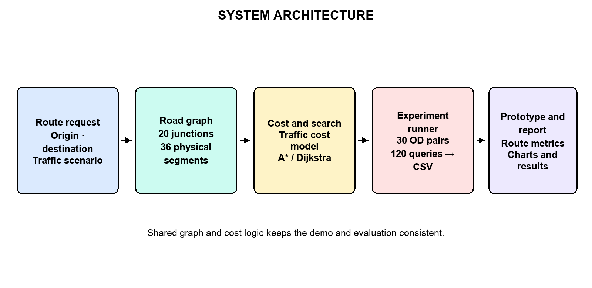
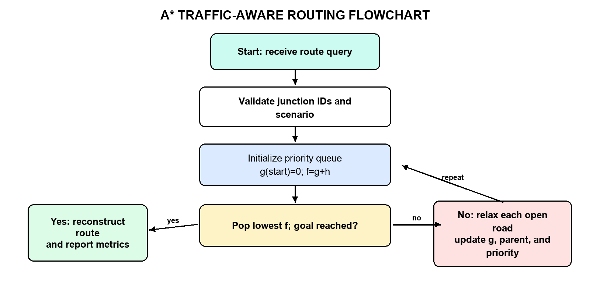
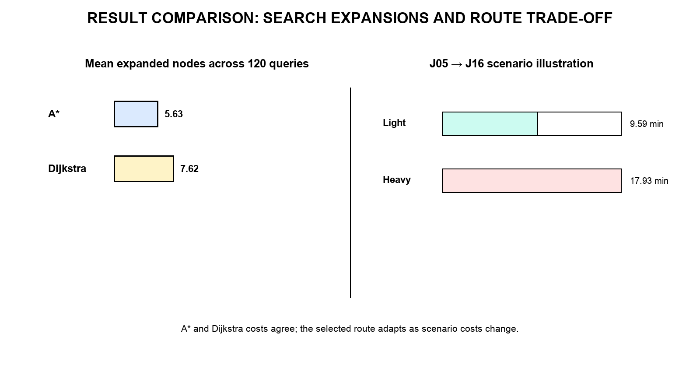
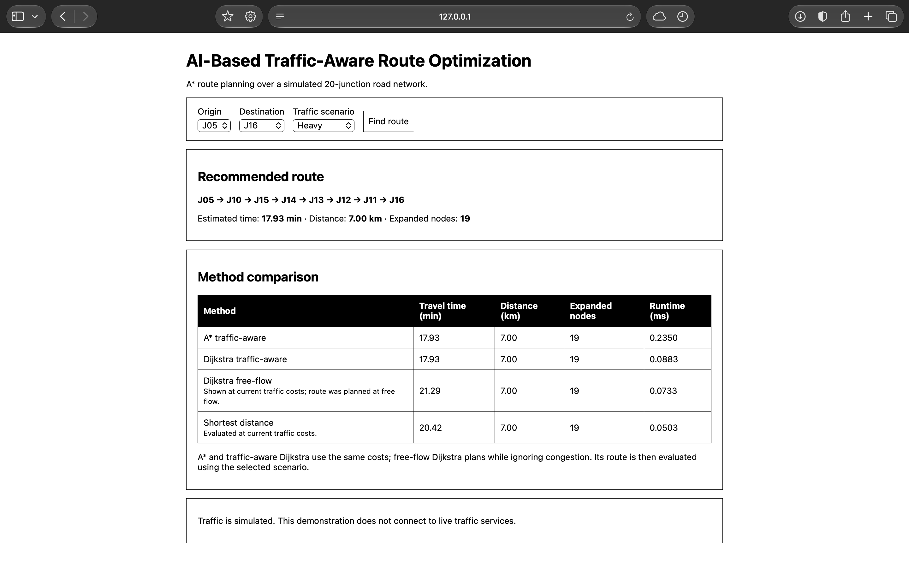

# AI-Based Traffic-Aware Route Optimization

A Python mini-project that uses **A\*** search to find a low-travel-time route in a small, directed road network under repeatable simulated traffic conditions. The project compares traffic-aware routing with Dijkstra, free-flow planning, and shortest-distance routing.

Traffic is simulated. The prototype does not use live traffic feeds, GPS data, or a trained traffic-prediction model.

## Project at a glance

| Item | Description |
|---|---|
| Problem | Choose a route between two junctions with minimum estimated travel time under a selected traffic scenario. |
| AI technique | A\* graph search with an admissible straight-line-distance heuristic. |
| Network | 20 junctions and 36 physical road segments, with directed links, one-way roads, alternate paths, and an expressway. |
| Scenarios | Light, moderate, heavy, and incident traffic; incident scenario closes segment S08. |
| Evaluation | 30 fixed origin–destination pairs across four scenarios (120 queries). |
| Main result | A\* and traffic-aware Dijkstra agree on the optimal travel-time cost for all 120 included evaluation queries. |

## Problem definition and objectives

Road users need to reach a destination while avoiding delays on congested roads. This prototype represents the road system as a graph and assigns each road a travel-time cost based on its length, free-flow speed, and the selected traffic factor.

The project objectives are to:

1. Formulate route planning as a state-space search problem.
2. Implement A\* and explain why its heuristic is admissible.
3. Compare its results with Dijkstra and routes planned without congestion information.
4. Evaluate route cost, distance, expanded nodes, and runtime on reproducible test cases.
5. Show routes and observations through the included diagrams, results, and captured UI.

## AI problem formulation

The road network is a directed graph `G = (V, E)`:

- **State:** the current junction.
- **Initial state:** the origin selected for a query.
- **Goal state:** the destination junction.
- **Action:** traverse an outgoing directed road segment.
- **Path cost:** sum of estimated travel times for all road segments on the path.
- **Unavailable action:** a road closed in the selected scenario cannot be traversed.

For an open road `e`, estimated time is:

```text
cost(e) = distance_km(e) / speed_kmh(e) × 60 × traffic_factor(e)
```

A\* ranks each candidate state using `f(n) = g(n) + h(n)`, where `g(n)` is the cost already incurred and:

```text
h(n) = straight_line_distance_to_goal_km / 100 km/h × 60
```

The network's maximum speed is 100 km/h. Road lengths are at least their straight-line endpoint distances, and traffic factors are at least 1. The heuristic therefore does not overestimate the remaining travel time. Setting `h(n) = 0` gives Dijkstra's algorithm.

## Network and test data

The deterministic synthetic network has a 5 × 4 arrangement of junctions labelled J01–J20 and 36 physical segments. Most roads are two-way; selected horizontal and vertical roads are one-way. Four diagonal connectors provide alternate routes, and a high-speed expressway creates a case where a fastest route can differ from a distance-minimum route.

Traffic multipliers are fixed in `traffic_route.py` so that experiments can be reproduced:

| Scenario | Central-road factor | Outer-road factor | Special condition |
|---|---:|---:|---|
| Light | 1.15× | 1.00× | None |
| Moderate | 1.75× | 1.20× | None |
| Heavy | 2.60× | 1.55× | None |
| Incident | 2.00× | 1.25× | Segment S08 closed |

The evaluation uses 30 seeded origin–destination pairs for each scenario. The same selected pair and scenario are used when comparing methods.

## Methods compared

- **A\* traffic-aware:** finds the minimum travel-time route using the heuristic above.
- **Dijkstra traffic-aware:** uses the same traffic-adjusted costs and serves as the optimal-cost check.
- **Dijkstra free-flow:** selects a route while ignoring congestion, then evaluates that route using the selected scenario's traffic costs. The incident closure is still respected.
- **Shortest distance:** minimizes kilometres while respecting the selected scenario's road closure, then reports its travel time under that scenario.

## System architecture



The main algorithm flow is:



## Implementation

The routing and evaluation code uses the Python standard library. The report-generation scripts use Pillow and `python-docx`.

| File or folder | Purpose |
|---|---|
| `traffic_route.py` | Synthetic graph, scenario costs, A\*, Dijkstra, shortest-distance search, and route metrics. |
| `evaluate.py` | Reproducible 120-query comparison and CSV writer. |
| `evaluation_results.csv` | Included measured results; running the evaluation refreshes this file. |
| `app.py` | Legacy HTTP API and static-file server. Its expected static web folder is currently missing; see Known limitation. |
| `make_figures.py` | Generates the report's diagrams and charts. |
| `make_report.py` | Generates the editable Word report using the CSV and figures. |
| `figures/` | Twelve report diagrams, UI illustrations, and result figures. |
| `screenshots/application_running.png` | Captured application screen included as demonstration evidence. |
| `AI-Based_Traffic_Aware_Route_Optimization_Report.pdf` | Completed 48-page report. |
| `AI-Based_Traffic_Aware_Route_Optimization_Report.docx` | Editable version of the report. |

## Run the evaluation

Requires Python 3.10 or newer. No third-party packages are needed for routing or evaluation.

```bash
cd ai-traffic-aware-route-optimization
python3 evaluate.py
```

The command writes 120 rows to `evaluation_results.csv` and prints aggregate metrics. To inspect one route directly:

```bash
python3 -c "from traffic_route import search; print(search('J05', 'J16', 'heavy'))"
```

To regenerate the report figures and DOCX:

```bash
python3 -m pip install Pillow python-docx
python3 make_report.py
```

`make_report.py` creates the DOCX and figures; PDF conversion is a separate step. The supplied PDF and DOCX remain in this folder.

## Evaluation metrics and included results

The experiment records:

- Estimated travel time and path distance.
- Expanded search nodes and measured runtime for A\* and Dijkstra.
- Travel-time difference between the A\* route and the free-flow-planned route evaluated at current traffic.
- A\*/Dijkstra optimal-cost agreement.

For the included `evaluation_results.csv`:

| Measure | Result |
|---|---:|
| Origin–destination/scenario queries | 120 |
| A\*/Dijkstra optimal-cost agreements | 120 / 120 (100%) |
| Mean A\* expanded nodes | 5.63 |
| Mean Dijkstra expanded nodes | 7.63 |
| Mean A\* runtime | 0.0226 ms |
| Mean Dijkstra runtime | 0.0214 ms |
| Mean saving against free-flow route at scenario traffic | 0.391 min |

Runtime differences on this small graph are too small to establish a reliable speed advantage; node expansions provide another search-efficiency measure. Results are specific to this synthetic network and seeded test set.

### Example: J05 to J16 in heavy traffic

The included test data gives an A\* route of `J05 → J10 → J15 → J14 → J13 → J12 → J11 → J16`, taking **17.93 minutes** over **7.00 km**. A\* and traffic-aware Dijkstra agree on the route cost. The route selected by free-flow planning takes **21.29 minutes** when evaluated under heavy traffic, while the shortest-distance route takes **20.42 minutes** under those conditions.



## Demonstration screenshot

This is the supplied browser capture for the J05 → J16 heavy-traffic example. It shows the selected route, estimated time and distance, expanded nodes, and method comparison.



## Figure and diagram index

The PNG figures below are present in `figures/` and can be opened directly:

| Figure | Contents |
|---|---|
| [01 — System architecture](figures/figure_01_system_architecture.png) | Project components and information flow. |
| [02 — A\* flowchart](figures/figure_02_astar_flowchart.png) | Search steps from initialization to route reconstruction. |
| [03 — Use-case diagram](figures/figure_03_use_case.png) | User actions supported by the prototype. |
| [04 — Data model](figures/figure_04_data_model.png) | Junction, road, and traffic-scenario relationships. |
| [05 — UML classes](figures/figure_05_uml_classes.png) | Main implementation classes and responsibilities. |
| [06 — Search architecture](figures/figure_06_search_architecture.png) | Search components and cost calculation. |
| [07 — Workflow](figures/figure_07_workflow.png) | Experiment and route-planning workflow. |
| [08 — Application screen illustration](figures/figure_08_application_screen.png) | Report interface illustration. |
| [09 — UI wireframe](figures/figure_09_ui_wireframe.png) | Planner layout concept. |
| [10 — Traffic scenario chart](figures/figure_10_scenario_chart.png) | Scenario traffic factors. |
| [11 — Method comparison chart](figures/figure_11_comparison_chart.png) | Measured method comparison. |
| [12 — Road-network route](figures/figure_12_road_network_route.png) | Example route across the synthetic network. |

## Limitations and known issue

- Traffic is simulated with fixed scenario factors; the system does not connect to a live traffic provider or predict changing traffic.
- The road map is a small schematic graph, not a geographic map or large-scale road dataset.
- Vehicle counts and the application screenshot are demonstration material, not measured traffic volumes.
- `app.py` expects static browser files in a sibling `web/` directory, which is absent from this folder. Its browser page cannot be launched from the supplied files as-is. The Python routing and evaluation commands above work independently.
- The report and screenshot are included as existing project deliverables; updating this README does not regenerate or revise them.
